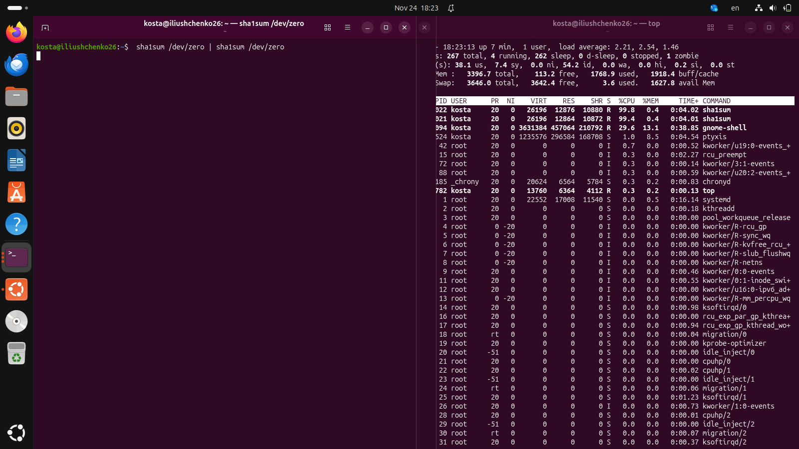
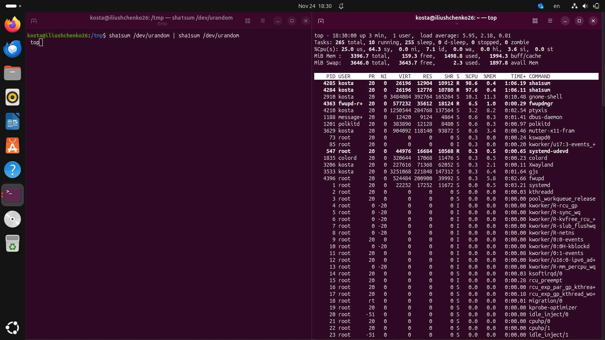
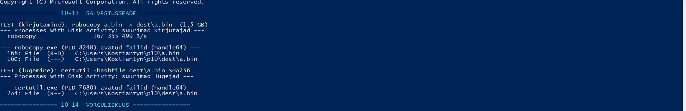
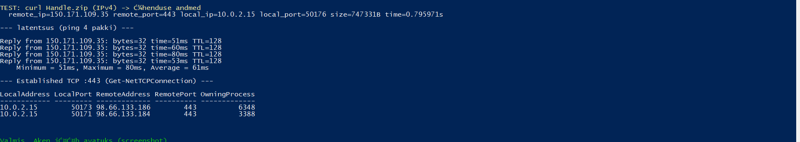

# Praktikum 10 — ressursside haldamine

**Kostiantyn Iliushchenko** · VirtualBox 7.2.16 · Ubuntu 26.10 (`OS-Iliushchenko-Ubuntu26`) · Windows 11 25H2 (`OS-Iliushchenko-W11`)

Mõõtmised 24.11.2026: Linux 18:18–18:36, Windows 18:36–19:40.

## 10-1 Mitu protsessi töötab

* Linux: **269** (`ps aux | wc -l`)
* Windows: **148** (Task Manager → Processes; `(Get-Process).Count`)

## 10-2 Kõige esimesena käivitatud protsess

* Linux: `/usr/lib/systemd/systemd` (PID 1) — `ps -p 1 -o pid,lstart,cmd`
* Windows: `smss.exe` (esimene kasutajaruumi protsess; `System` PID 4 loob tuum) — Process Explorer → Start Time

## 10-3 Milliste kasutajate protsessid töötavad

* Linux: `root`, `kosta`, `gdm-greeter`, `avahi`, `_chrony`, `colord`, `cups-browsed`, `geoclue`, `messagebus`, `polkitd`, `rtkit`, `syslog`, `systemd-oom`, `systemd-resolve` — `ps -eo user --no-headers | sort -u`
* Windows: `SYSTEM`, `LOCAL SERVICE`, `NETWORK SERVICE`, `Kostiantyn` (+ `UMFD-0/1`, `DWM-1`) — Task Manager → Details → User name

## 10-4 Uptime

* Linux: **5 min** (boot 24.11.2026 18:15:57) — `uptime`, `uptime -s`
* Windows: **2 min 59 s** (boot 24.11.2026 18:33:15) — `Win32_OperatingSystem.LastBootUpTime`

## 10-5 Viimasena käivitatud protsess

* Linux: `glycin-svg` (PID 4590, 18:31:50) — GNOME SVG-laadur, käivitus vahetult enne päringut — `ps -eo pid,user,lstart,cmd --sort=start_time | tail`
* Windows: `backgroundTaskHost.exe` (18:36:14) — Task Manager → Details → Start time

## 10-6 Kõige rohkem protsessoriaega

* Linux: `gnome-shell` — **5,4 %** — `ps -eo pcpu,pid,user,comm --sort=-pcpu`
* Windows: `MsMpEng.exe` (Windows Defender) — **60 %** — Task Manager → Processes → CPU

## 10-7 Kõige rohkem virtuaalmälu (VSZ)

* Linux: `gnome-shell` — **3 548 036 KiB** (~3,4 GiB) — `ps -eo vsz,pid,user,comm --sort=-vsz`
* Windows: `msedgewebview2` — **3 703 456 MB** reserveeritud virtuaalaadressiruumi — Process Explorer → Virtual Size

## 10-8 Kõige rohkem füüsilist mälu (RSS)

* Linux: `gnome-shell` — **430 736 KiB** (~420 MiB) — `ps -eo rss,pid,user,comm --sort=-rss`
* Windows: `MsMpEng.exe` — **283 MB** — Task Manager → Processes → Memory

## 10-9 Füüsiline mälu

* Linux: kokku **3396 MiB**; vaba **281 MiB (8,3 %)**; hõivatud **1358 MiB (40,0 %)**; buff/cache 2031 MiB — `free -h`
* Windows: kokku **8173 MB**; vaba **5574 MB (68,2 %)**; hõivatud **2599 MB (31,8 %)** — Task Manager → Performance → Memory

## 10-10 Vaba ruum põhikettal

* Linux: `/` — **6,3 GB vaba (25 %)**, kokku 25 GB, kasutusel 73 % — `df -h /`
* Windows: `C:` — **25,1 GB vaba (39,9 %)**, kokku 62,9 GB — `Win32_LogicalDisk`

## 10-11 Suurim fail ja suurim kaust

* Linux: fail `/swap.img` **3,56 GiB**; kaust `/usr` **7,57 GiB** — `sudo find / -xdev -type f`, `sudo du -x -d 1 /`
* Windows: fail `C:\pagefile.sys` **1,88 GB**; kaust `C:\Windows` **31,3 GB** — WinDirStat, `robocopy /L /E /BYTES`

## 10-12 `sha1sum /dev/zero` vs `sha1sum /dev/urandom`

* `/dev/zero`: **us 38,1 % / sy 7,4 %** — mõlemad `sha1sum`-id ainult hashivad nullebaiti kasutajaruumis.
* `/dev/urandom`: **us 19,8 % / sy 53,0 %** (+ si 11,9 %) — andmed genereerib tuum (ChaCha20), seega aeg läheb süsteemirežiimi.
* Mõlemal juhul 2 × `sha1sum` ~100 % CPU-d; erineb ainult jaotus `us` ja `sy` vahel.

## 10-13 Salvestusseade (Windows)

Test suure failiga, mõõdetud Resource Monitori `IO Write/Read Bytes/sec` ja `handle64` abil:

* 10-13-1 kirjutab kõige rohkem: `robocopy.exe` — **167 355 499 B/s**
* 10-13-2 fail: `C:\Users\Kostiantyn\p10\dest\a.bin`
* 10-13-3 loeb kõige rohkem: `certutil.exe` (hashis 1,5 GB faili)
* 10-13-4 fail: `C:\Users\Kostiantyn\p10\dest\a.bin`

## 10-14 Võrguliiklus (Windows)

Suurim liiklus oli `curl.exe` allalaadimisel:

* protsess: `curl.exe`
* kohalik IP ja port: **10.0.2.15 : 50176**
* teine pool: **150.171.109.35 : 443**
* latentsus: **51–80 ms** (4 pakki, keskmine **61 ms**)
* kogumaht: **747 331 baiti**, 0,796 s (~0,94 MB/s)

## 10-15 Aeglase arvuti põhjuse tuvastamine (Windows)

Jälgin järgmisi tööriistu ja väärtusi:

* Task Manager → Processes: sorteerin CPU, Memory, Disk, Network veeru järgi; otsin protsenti, mis püsib üle 30 % CPU või üle 1 MB/s kettal. Vaatan ka Startup ja Users vahelehte.
* Resource Monitor → Disk: `Read (B/sec)`, `Write (B/sec)`, `Disk 0 (C:) Queue Length` (häire, kui üle 2) ja `Highest Active Time` (üle 80 %).
* Resource Monitor → Memory: `Hard Faults/sec` (üle 100) ja `Used Physical Memory` (üle 90 %) viitavad mälupuudusele.
* Resource Monitor → Network: `Processes with Network Activity` → `Total (B/sec)`, et leida taustal tõmbav protsess.
* Autoruns: Logon, Services, Scheduled Tasks — otsin tundmatuid autostart-kirjeid.
* Process Explorer: CPU, Private Bytes, I/O Delta ja VirusTotal nupp protsessi kontrollimiseks.
* WinDirStat: kui ketas on täis, näitab suurimad kaustad ja failid.
