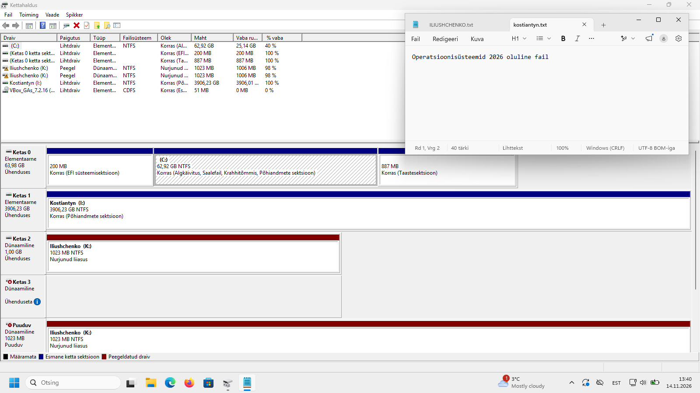
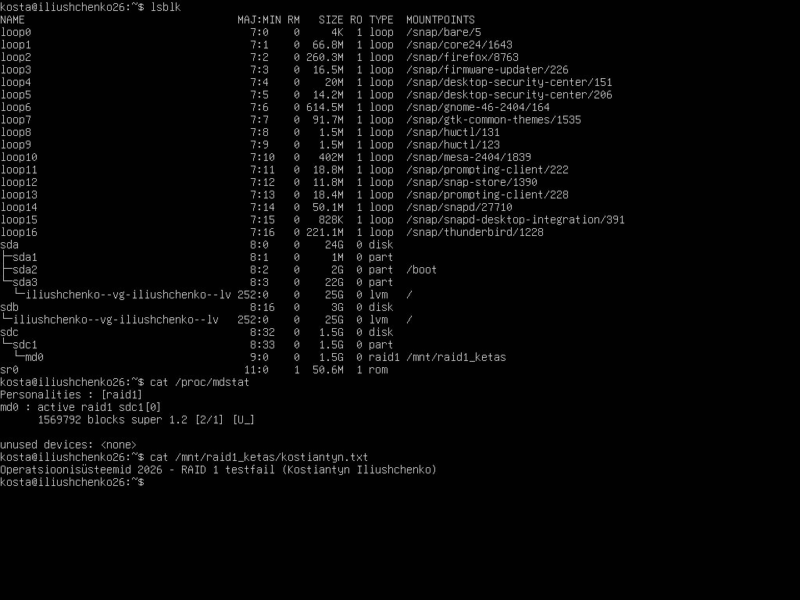
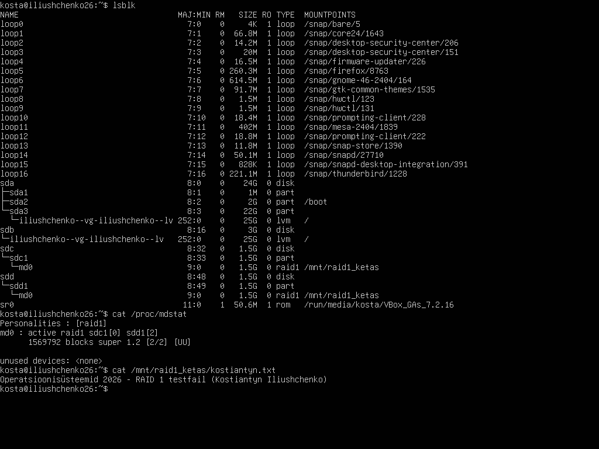
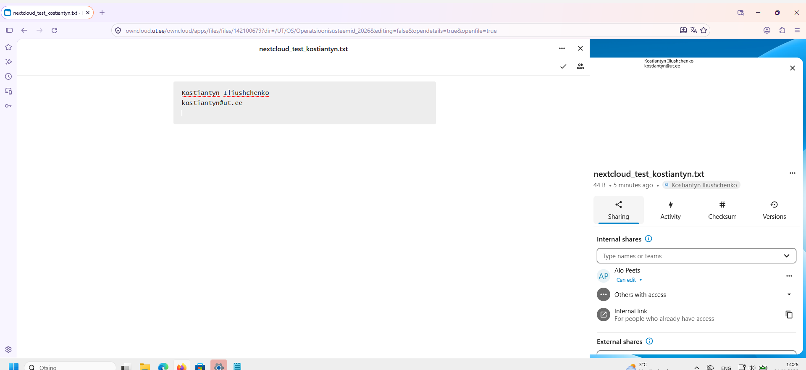
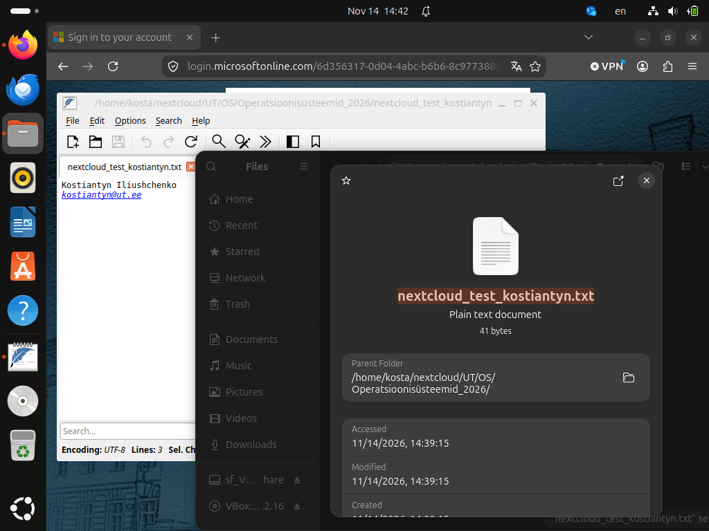
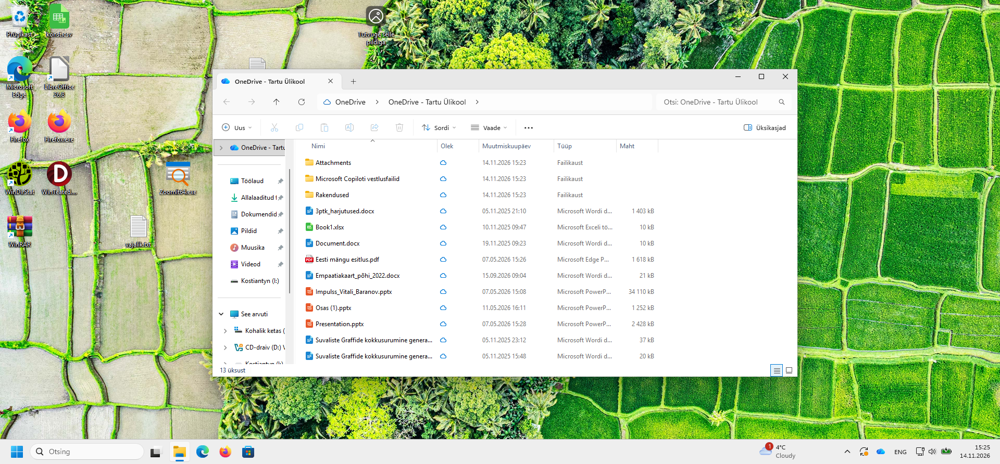

# Praktikum 8 — RAID ja andmete varundamine

**Kostiantyn Iliushchenko** · VirtualBox 7.2.16 · Windows 11 25H2 (`OS-Iliushchenko-W11`) · Ubuntu 26.04 (`OS-Iliushchenko-Ubuntu26`)

## 8-1 RAID 1 Windowsis

* Lisatud 2×1 GB ketast, mõlemad lähtestatud MBR-ina.
* `diskpart`: `K:` NTFS, silt `Iliushchenko`; `convert dynamic` + `add disk=3` → peegel.
* Fail `K:\kostiantyn.txt`: **Operatsioonisüsteemid 2026 oluline fail**.
* Rike: teine ketas offline → volume `Nurjunud liiasus`, ketas `Puuduv`, `K:` jäi loetavaks.

## 8-2 RAID 1 Ubuntus

* 2×1,5 GB ketast (`sdc`, `sdd`), `fdisk` partitsioonitüüp `fd`.
* `mdadm --create /dev/md0 --level=1 --raid-devices=2 /dev/sdc1 /dev/sdd1` → `mkfs.ext4` → `/mnt/raid1_ketas`.
* Püsivus: `/etc/fstab` (`nofail`), `/etc/mdadm/mdadm.conf` (`ARRAY /dev/md0`), `update-initramfs -u`.
* Rike: `[2/1] [U_]`; `nofail` tõttu emergency mode'i ei läinud. Asendusketas + `mdadm --add` → `[2/2] [UU]`.

## 8-3 Nextcloud Windowsis

Fail `nextcloud_test_kostiantyn.txt` kaustas `UT/OS/Operatsioonisüsteemid_2026`, jagatud **Alo Peets**iga (`Can edit`).

## 8-4 Nextcloud Ubuntus

`nextcloud-desktop` 4.0.6; fail `~/nextcloud/UT/OS/Operatsioonisüsteemid_2026/`.

## 8-5 OneDrive

OneDrive'i klient Windowsis TÜ Microsoft 365 kontoga; sünkroonitud kaust `OneDrive - Tartu Ülikool`.

**Järeldus:** RAID 1 annab liiasuse, mitte varunduse; `nofail` muudab degradeeritud massiivi käivitumist.
