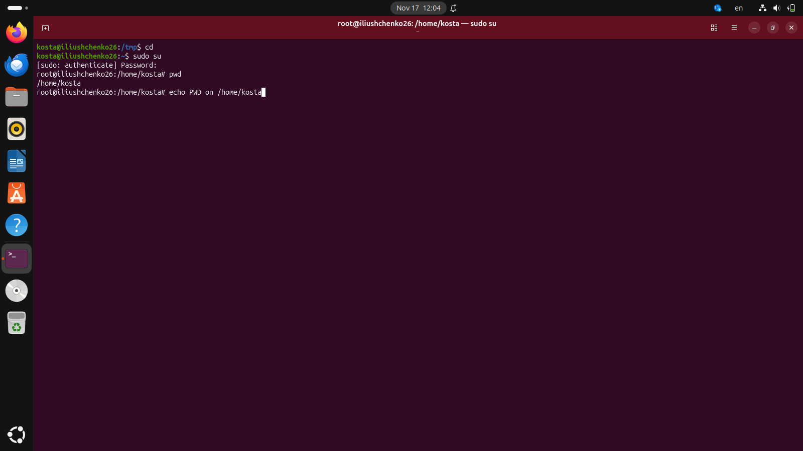
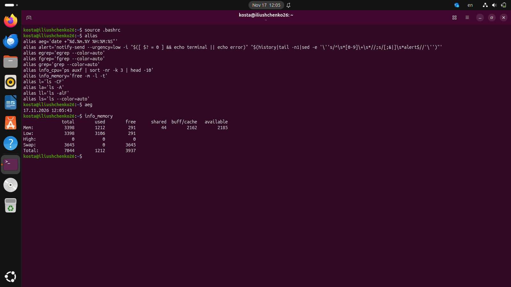
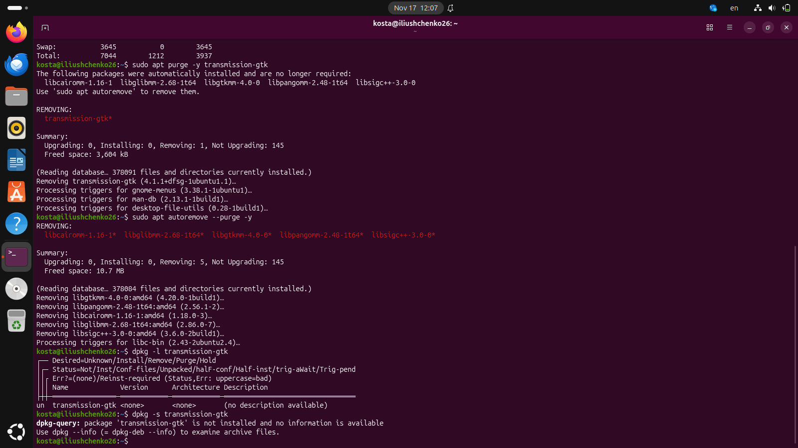
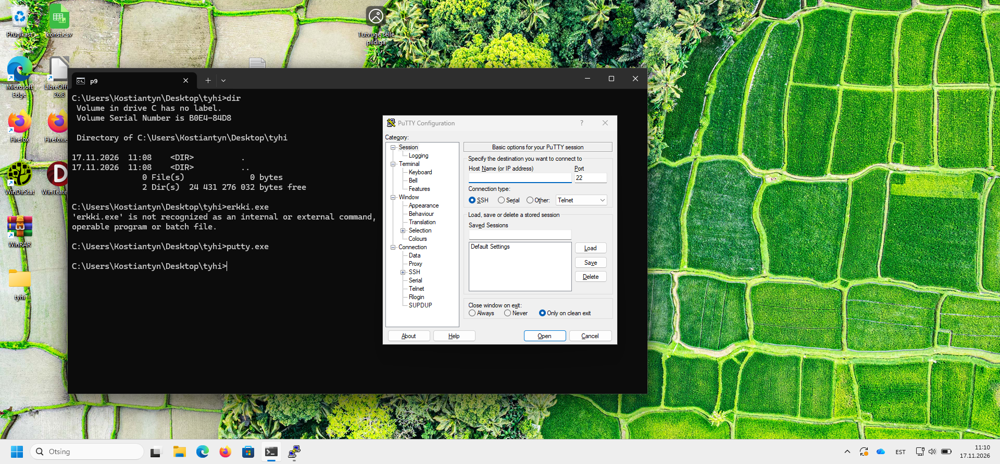
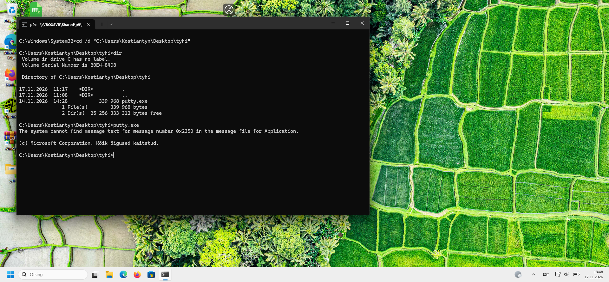
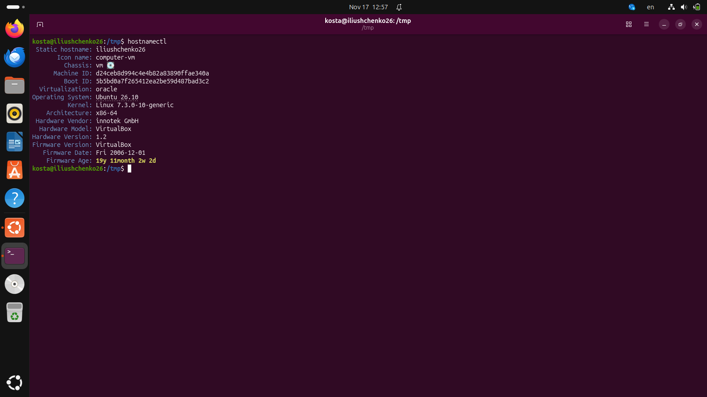

# Praktikum 9 — Teenused ja optimeerimine

**Kostiantyn Iliushchenko** · VirtualBox 7.2.16 · Windows 11 25H2 (`OS-Iliushchenko-W11`) · Ubuntu 26.04 → 26.10 (`OS-Iliushchenko-Ubuntu26`)

## 9-1 `PWD` `sudo su` all

* `sudo su` annab root-õigused, aga **ei vaheta töökataloogi** (`sudo su -` viiks hoopis `/root`-i).
* `pwd` → **`/home/kosta`** — see ongi `$PWD` väärtus.

## 9-2 Aliased

* Lisasin `~/.bashrc`-i: `aeg`, `info_cpu`, `info_memory`.
* `source .bashrc` → `alias` näitab kõiki kolme; `aeg` → `17.11.2026 12:05:43`, `info_memory` → mälutabel.
* Uues terminalis ilma `source`-ita on aliased kadunud (ajutised).

## 9-3 Üleliigne tarkvara

* Valik: `transmission-gtk` — BitTorrenti klient; õppetöö VM-is pole torrentitega midagi teha ja klient kuulab lisaks võrguporti.
* `sudo apt purge -y transmission-gtk` → 3,6 MB, `sudo apt autoremove --purge -y` → veel 10,7 MB.
* **Vabastatud ~14,3 MB**; `dpkg -s` → paketti enam ei ole.

## 9-4 EXE otsimine `%Path%` järgi

* Tühi kaust `Desktop\tyhi`: `erkki.exe` → *is not recognized*, `putty.exe` → käivitub `C:\Program Files\PuTTY\` kaustast.
* Kopeerisin sinna `cmd.exe` nimega `putty.exe` (339 968 B vs PuTTY 1 341 080 B) → käivitub **kaustas olev** fail.
* Põhjus: cmd otsib esimesena jooksvas kaustas, alles siis `%Path%`-st.

* Linuxis jooksvat kausta `$PATH`-i ei lisata (`./programm`), Windowsis lisatakse → **Linuxi lähenemine on turvalisem** (pahatahtliku samanimelise EXE-i istutamine kausta).

## 9-5 Kasutaja vs süsteemi `%Path%`

* `echo %Path%`: süsteemiteed on ees, kasutaja `WindowsApps` alles lõpus — kasutaja `Path` liidetakse süsteemi omale järele.
* **Vastus: käivitub süsteemi `%Path%`-i kaustas olev EXE**, sest see kaust on nimekirjas eespool.

## 9-6 Teenus perenime esitähega (I) — `InventorySvc`

* 271 teenust, neist 92 töötavad ja 66 automaatsed. I-tähega: `icssvc`, `IKEEXT`, `InstallService`, `InventorySvc`, `iphlpsvc`, `IpxlatCfgSvc`, `IsoEnvBroker`, `IsolationSession`.
* `InventorySvc` — *Inventory and Compatibility Appraisal service* (`svchost -k InvSvcGroup`, LocalSystem, sõltub `RpcSs`), seis `AUTO_START (DELAYED)`.
* Kogub inventuuri ja telemeetriat (`CompatTelRunner`) — õppetöö VM-is mittevajalik, kulutab ainult CPU-d ja ketast.
* Sõltuvaid teenuseid pole → **võib `disabled`** (`sc config InventorySvc start= disabled`, vajab admin-õigusi).

## 9-7 AppX-paketi eemaldamine

* Valik: `Microsoft.MicrosoftSolitaireCollection` (75,8 MB) — mäng.
* `Get-AppxPackage ... | select packageFullName` → `Microsoft.MicrosoftSolitaireCollection_4.27.9181.0_x64__8wekyb3d8bbwe`
* `Remove-AppxPackage -Package ...` → korduskäsk annab **tühja väljundi**.

## 9-8 Ubuntu 26.10

* 26.04.1 LTS (`resolute`, kernel 7.0.0) → `sed resolute→stonking` + `apt full-upgrade` (~1600 pakki) + `base-files` uuesti + `autoremove` + reboot.
* Tulemus: **Ubuntu 26.10**, kernel **7.3.0-10-generic**.
* GA: ISO 7.2.16 ei kompileeru kernel 7.3-ga (`vboxsf` `dirops.c` viga) → eemaldasin ISO lisad, jäid Ubuntu in-tree moodulid (7.2.20); `sf_Shared` / `sf_VM_Share` töötavad.

**Järeldus:** suurim võit tuli liigsest tarkvarast (~14 MB + 76 MB AppX) ja telemeetria-teenusest; kernelihüpe 7.3 lõhkus VirtualBoxi ISO-lisad, aga Ubuntu enda moodulid päästsid olukorra.
